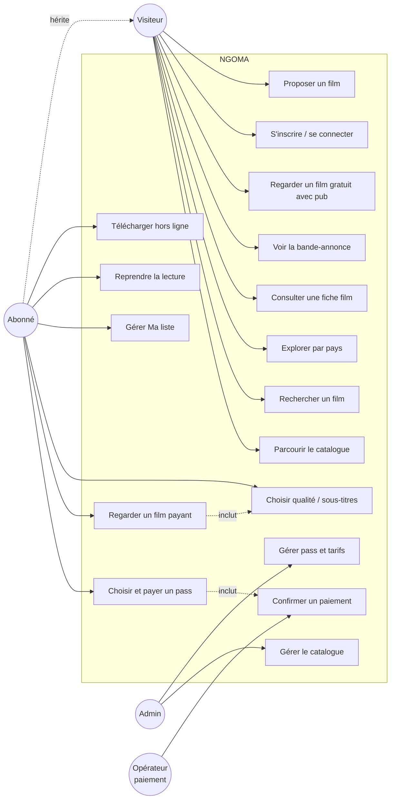
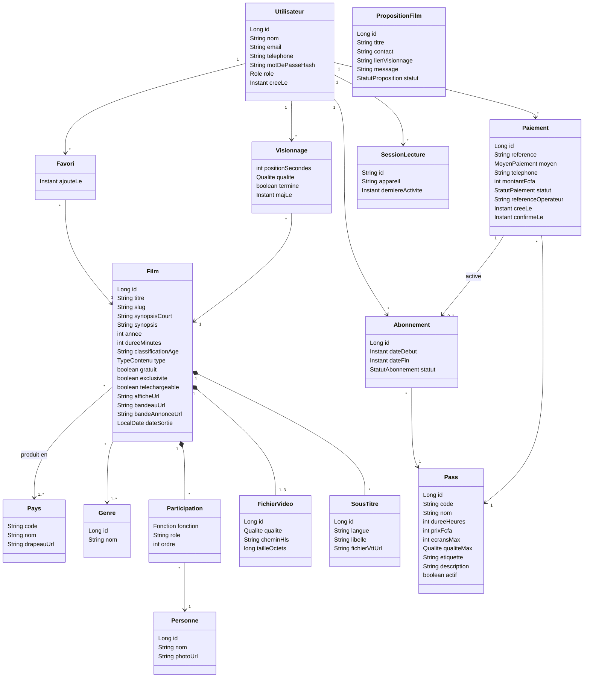
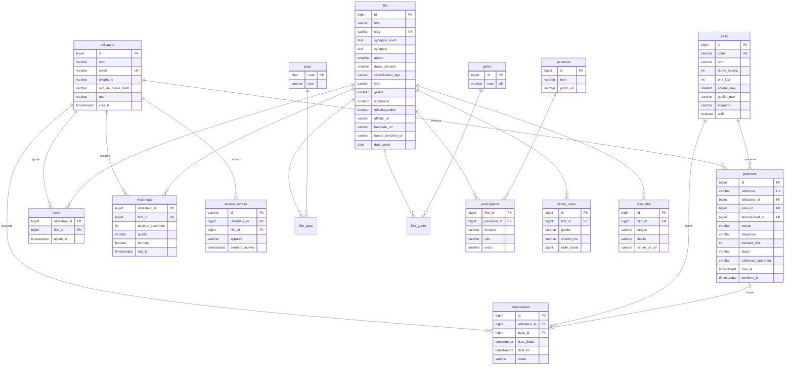
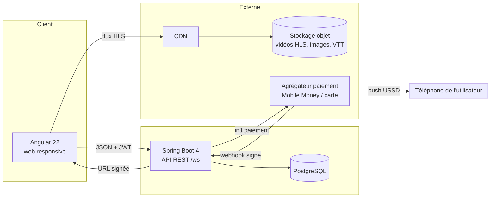
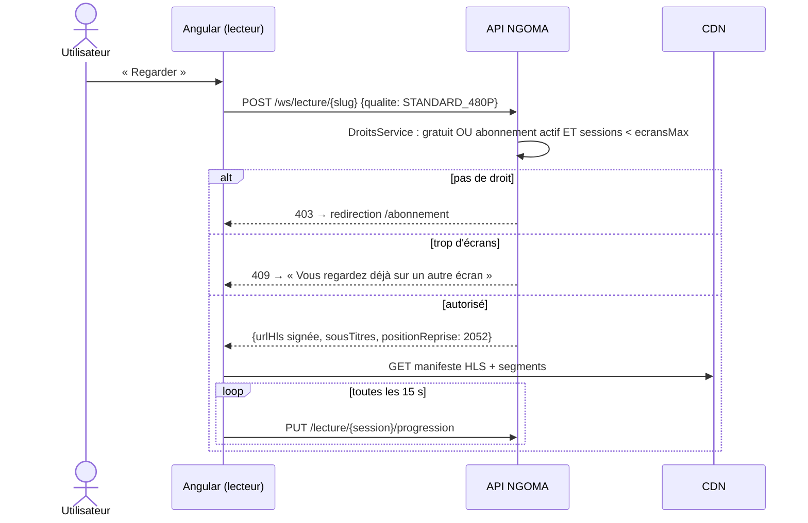

# NGOMA — Dossier de conception

> Plateforme de streaming de films africains.
> Conception établie à partir des maquettes : **Accueil**, **Fiche film**, **Abonnement & paiement Mobile Money**, **Lecteur vidéo**.
> Stack cible : **Spring Boot 4 (Java 17) + PostgreSQL** pour le backend, **Angular 22** pour le frontend.

---

## 1. Contexte et objectifs

NGOMA propose le cinéma africain en streaming, pensé pour les réalités du continent :

- **Paiement par pass courts** (jour / semaine / mois), sans engagement, via **Mobile Money** (Orange Money, MTN MoMo, Wave, Moov Money) ou carte bancaire, en **FCFA**.
- **Faible consommation de données** : qualités 240p / 480p / 1080p, mode « économie de données ».
- **Téléchargement hors ligne** (application) pour regarder sans connexion.
- **Sous-titres et langues** : français, anglais et langues locales.
- **Catalogue gratuit financé par la publicité** en plus du catalogue payant.
- **Découverte par pays** (Côte d'Ivoire, Sénégal, Nigeria, Ghana, Cameroun, Mali, Burkina Faso, RD Congo, Afrique du Sud…).

---

## 2. Acteurs

| Acteur | Description |
|---|---|
| **Visiteur** | Non connecté. Parcourt le catalogue, voit les fiches et bandes-annonces, regarde les films gratuits avec publicité. |
| **Abonné** (utilisateur inscrit) | Se connecte, achète un pass, regarde les films payants, gère « Ma liste », reprend la lecture. Un utilisateur inscrit sans pass actif a les droits d'un visiteur + « Ma liste ». |
| **Administrateur** | Gère le catalogue (films, personnes, pays, genres), les fichiers vidéo, les pass et les tarifs. Consulte les paiements. |
| **Ayant droit / réalisateur** | Propose un film via le formulaire « Proposer un film » (lien du pied de page). |
| **Opérateur de paiement** *(système externe)* | Agrégateur Mobile Money / carte (ex. CinetPay, PayDunya, FedaPay). Envoie les confirmations par webhook. |

---

## 3. Cas d'utilisation



### Cas détaillé — UC8 « Choisir et payer un pass » (écran *Abonnement et paiement*)

| Élément | Contenu |
|---|---|
| Acteur | Abonné (connecté) |
| Pré-condition | Utilisateur authentifié |
| Scénario nominal | 1. Choisit un pass (Jour / Semaine / Mois). 2. Choisit un moyen de paiement. 3. Saisit son numéro (préfixe pays, ex. +225). 4. Vérifie le récapitulatif (pass, durée, moyen, total) et clique « Payer [PRIX] FCFA ». 5. Le système crée un paiement `EN_ATTENTE` et l'envoie à l'opérateur. 6. L'utilisateur valide sur son téléphone avec son code secret. 7. L'opérateur notifie NGOMA (webhook). 8. Le système active l'abonnement et affiche « Paiement confirmé — Votre Pass … est actif. Bon film ! ». |
| Alternatives | 6a. Refus / délai dépassé → paiement `ECHOUE`, bouton « Revenir au paiement ». 2a. Carte bancaire → redirection vers la page sécurisée de l'opérateur. |
| Post-condition | Un `Abonnement` actif de `dateDebut = confirmation` à `dateFin = dateDebut + durée du pass`. |

### Cas détaillé — UC9 « Regarder un film payant » (écran *Lecteur vidéo*)

1. Depuis la fiche, l'utilisateur clique « Regarder ».
2. Le système vérifie les droits : film gratuit, **ou** abonnement actif **et** nombre d'écrans simultanés < limite du pass.
3. Le système renvoie une URL de lecture signée (HLS) pour la qualité demandée et la liste des sous-titres.
4. Pendant la lecture, la position est sauvegardée périodiquement (reprise « [0:34:12] / [1:52:00] »).
5. En fin de film, le bloc « À suivre » propose d'autres titres.

---

## 4. Exigences

### Fonctionnelles (issues des maquettes)

| # | Écran | Exigence |
|---|---|---|
| F1 | Accueil | Navigation : Accueil, Films, Séries, Par pays, Gratuit, Ma liste, Rechercher, Se connecter, S'abonner. |
| F2 | Accueil | Bandeau « À la une · Exclusivité » : visuel 16:9, titre, genre · pays · année · durée · langues, synopsis court, boutons *Regarder* et *Ma liste*. |
| F3 | Accueil | Encart pass : « Pass dès [PRIX] FCFA par jour », logos des moyens de paiement, bouton *Voir les pass*. |
| F4 | Accueil | Carrousels : *Explorer par pays*, *Films · [pays]*, *Nouveautés*, *Gratuits avec publicité* (badge « Gratuit »), chacun avec *Tout voir*. |
| F5 | Accueil | Bloc « Pensé pour regarder partout » : économie de données, hors ligne, sous-titres. |
| F6 | Fiche film | Bandeau + affiche, titre, année · durée · genre · pays · réalisateur, badges (HD, sous-titres, hors ligne, classification d'âge). |
| F7 | Fiche film | Actions : *Regarder*, *Bande-annonce*, *Télécharger*. Synopsis complet. |
| F8 | Fiche film | Choix de la qualité de lecture (Économie 240p, Standard 480p, HD 1080p) avec description de consommation. |
| F9 | Fiche film | Distribution (photo, nom, rôle) et « Vous aimerez aussi ». |
| F10 | Paiement | Parcours en 3 étapes + récapitulatif + écran de confirmation (cf. UC8). |
| F11 | Lecteur | Vidéo 16:9, badge qualité, temps écoulé / durée, bascule économie de données, choix qualité et sous-titres (Aucun / Français / English…), bloc « À suivre ». |
| F12 | Pied de page | À propos, Aide, Proposer un film, Conditions d'utilisation, Confidentialité. |

### Non fonctionnelles

- **Performance réseau** : streaming adaptatif HLS, pages légères (images WebP, lazy-loading), API paginée.
- **Sécurité** : JWT (access court + refresh), mots de passe hachés (BCrypt), URLs vidéo signées et expirantes, vérification de signature des webhooks de paiement, idempotence des paiements.
- **Disponibilité** : vidéos servies via stockage objet + CDN, jamais par l'application Spring.
- **Responsive** : maquettes desktop (1440 px) déclinées mobile-first.
- **Accessibilité** : contrastes conformes WCAG AA sur fond sombre, navigation clavier du lecteur.
- **Internationalisation** : interface en français par défaut, prête pour l'anglais.

---

## 5. Modèle du domaine

### Diagramme de classes



### Énumérations

| Enum | Valeurs |
|---|---|
| `Role` | `ABONNE`, `ADMIN` |
| `TypeContenu` | `FILM`, `SERIE` |
| `Fonction` | `ACTEUR`, `REALISATEUR`, `SCENARISTE`, `PRODUCTEUR` |
| `Qualite` | `ECO_240P`, `STANDARD_480P`, `HD_1080P` |
| `MoyenPaiement` | `ORANGE_MONEY`, `MTN_MOMO`, `WAVE`, `MOOV_MONEY`, `CARTE` |
| `StatutPaiement` | `EN_ATTENTE`, `CONFIRME`, `ECHOUE`, `EXPIRE` |
| `StatutAbonnement` | `ACTIF`, `EXPIRE`, `ANNULE` |
| `StatutProposition` | `RECUE`, `EN_ETUDE`, `ACCEPTEE`, `REFUSEE` |

### Données de référence (issues de la maquette)

| Pass | Durée | Écrans | Qualité max | Étiquette | Description |
|---|---|---|---|---|---|
| Pass Jour | 24 h | 1 | HD | Pour essayer | Accès illimité pendant 24 h, 1 écran. |
| Pass Semaine | 7 jours | 1 | HD | Le plus choisi | 7 jours d'accès illimité. |
| Pass Mois | 30 jours | 2 | HD | Meilleur prix | 30 jours, 2 écrans, qualité HD. |

> Les prix (« [PRIX] FCFA ») restent à fixer : ils sont stockés en base et modifiables par l'administrateur.

| Qualité | Libellé | Conseil affiché |
|---|---|---|
| `ECO_240P` | Économie · 240p | Consomme le moins de données. Idéal en 3G. |
| `STANDARD_480P` | Standard · 480p | Bon équilibre entre image et données. |
| `HD_1080P` | HD · 1080p | Meilleure image. Recommandé en Wi-Fi ou 4G. |

---

## 6. Modèle physique (PostgreSQL)



Index utiles : `film(gratuit)`, `film(date_sortie DESC)`, `film_pays(pays_code)`, `abonnement(utilisateur_id, date_fin)`, `paiement(reference_operateur)`, recherche plein texte sur `film(titre, synopsis)` via `tsvector` + index GIN.

Le prix est **figé dans `paiement.montant_fcfa`** au moment de l'achat : une modification ultérieure du tarif d'un pass n'altère pas l'historique.

---

## 7. Architecture



Choix structurants :

- **La vidéo ne transite jamais par Spring.** L'API ne délivre qu'une URL HLS signée et expirante ; le lecteur lit directement depuis le CDN. Chaque film est encodé en 3 renditions (240p / 480p / 1080p) dans un manifeste HLS, ce qui permet à la fois un choix manuel de qualité et l'adaptation automatique.
- **Paiement asynchrone** : l'activation de l'abonnement est déclenchée uniquement par le webhook vérifié (et, en secours, par un job de vérification de statut), jamais par le client.
- **Monolithe modulaire** : un seul déployable Spring, découpé en paquets par domaine.

### Backend — organisation des paquets (`com.films.ngoma`)

Organisation en couches, alignée sur le projet de référence *guichet-unique-backoffice* :
`controller → facade (transactions + mapping DTO) → repository`.

```
com.films.ngoma
├── NgomaApplication          @EnableScheduling, bannière de démarrage
├── configuration/            WebConfig (CORS)
│   ├── logger/               @Logged, LogAspect, LogConfig
│   └── openapi/              OpenApi30Config (Swagger, schéma Bearer)
├── controller/               SecurityController, UtilisateurController, FilmController,
│                             PaysController, GenreController, PassController,
│                             AbonnementController, PaiementController
├── facade/                   FilmFacade, PaysFacade, GenreFacade, PassFacade,
│                             AbonnementFacade, PaiementFacade
├── service/                  SecurityService (UserDetailsService, connexion, inscription)
├── domain/                   AbstractEntity (audit + @Version), Utilisateur, Pays, Genre,
│                             Film, Pass, Abonnement, Paiement
├── enums/                    JpaConstants, Role, TypeContenu, Fonction, Qualite,
│                             MoyenPaiement, StatutPaiement, StatutAbonnement
├── exception/                CodeErreur (7000-7999), UtilisateurException, FilmException,
│   │                         PassException, PaiementException
│   └── configuration/        AbstractApplicationException, ApplicationErreur,
│                             CodeErreurTechnique (9000-9999), ExceptionHandlers, ...
├── presentation/dto/         PageDto, PaysDto, GenreDto, PassDto, UtilisateurDto,
│                             auth/, film/, abonnement/, paiement/
├── repository/               *Repository (Spring Data JPA)
├── security/                 SecurityConfig, JwtRequestFilter, JwtTokenUtils,
│                             SecurityUtils, LogoutService, PasswordConfig
└── task/                     ExpirationAbonnementTask (toutes les 5 min)
```

Migrations Flyway : `resources/flyway/schema/V0.0.1` (structure) et `resources/flyway/dev/V0.0.1` (données de référence : pays, genres, pass).

À venir : lecture (FichierVideo, SousTitre, SessionLecture, URL signée), Ma liste, distribution, propositions de films, administration, client de l'agrégateur de paiement. Les tables correspondantes existent déjà.

### Frontend — organisation Angular (composants *standalone*)

Structure alignée sur le projet de référence :

```
src/
├── environments/        environment.ts (apiUrl http://localhost:8090), environment.prod.ts
├── styles/              styles.scss, charte.scss (jetons), theme.scss (boutons, champs, badges),
│                        variables.scss (points de rupture)
├── assets/img/
└── app/
    ├── app.component.*  barre de chargement, header, router-outlet, footer, toasts
    ├── app.config.ts    HashLocationStrategy, locale fr, intercepteurs
    ├── app.routes.ts    routes en chargement différé
    ├── components/      header, footer, accueil, catalogue, fiche-film, lecteur,
    │                    abonnement, login, inscription, access-interdit,
    │                    shared/{film-card, film-rail, barre-chargement}
    ├── interceptors/    api.interceptor (préfixe API + Bearer + 401), chargement.interceptor
    ├── models/          film, pays, genre, pass, paiement, abonnement, qualite,
    │                    utilisateur, token, auth, page, application-erreur
    ├── services/        auth, navigation, chargement, message, film, pays, genre, pass,
    │                    abonnement, paiement, format ; permission/auth-guard
    └── validators/      custom-validators (téléphone, correspondance)
```

### Routage Angular

| Route | Écran | Garde |
|---|---|---|
| `/` | Accueil | — |
| `/films`, `/series`, `/gratuit` | Catalogue filtré | — |
| `/pays/:code` | Films d'un pays | — |
| `/recherche?q=` | Résultats | — |
| `/film/:slug` | Fiche film | — |
| `/regarder/:slug` | Lecteur | `authGuard` + vérification droits (sauf gratuit) |
| `/abonnement` | Choix du pass & paiement | `authGuard` |
| `/abonnement/confirmation/:reference` | Paiement confirmé / échoué | `authGuard` |
| `/ma-liste` | Ma liste | `authGuard` |
| `/connexion`, `/inscription` | Compte | — |
| `/proposer-un-film`, `/aide`, … | Pages statiques | — |
| `/mon-compte` | Profil, photo, pass, mot de passe | `authGuard` |
| `/admin` → `/admin/films` | Back-office : liste des films | `adminGuard` |
| `/admin/films/nouveau`, `/admin/films/:id` | Back-office : création / modification d'un film | `adminGuard` |
| `/acces-interdit` | Page « Accès interdit » (redirection d'`adminGuard`) | — |

---

## 8. API REST

Préfixe `/ws` (propriété `api.prefix`, comme dans le projet de référence). Authentification `Authorization: Bearer <jwt>`. Listes paginées `?page=&taille=`.

### Endpoints implémentés (socle)

| Méthode | Endpoint | Accès |
|---|---|---|
| `POST` | `/ws/securite/auth` · `/ws/securite/inscription` | Public → `{token}` |
| `GET` | `/ws/film/lister?motCle=&genreId=&paysCode=&gratuit=&page=&taille=` | Public |
| `GET` | `/ws/film/{slug}` | Public |
| `GET` | `/ws/pays/lister` · `/ws/genre/lister` · `/ws/pass/lister` | Public |
| `GET` | `/ws/utilisateur/moi` | Connecté |
| `GET` | `/ws/abonnement/courant` | Connecté (204 si aucun) |
| `POST` | `/ws/paiement/initier` · `GET` `/ws/paiement/{reference}` | Connecté |
| `POST` | `/ws/paiement/notification` | Agrégateur (en-tête `X-Ngoma-Signature`) |
| `PUT` | `/ws/utilisateur/moi` · `/ws/utilisateur/moi/mot-de-passe` | Connecté |
| `GET` · `POST` · `DELETE` | `/ws/utilisateur/moi/photo` | Connecté (photo de profil, 2 Mo) |
| `POST` | `/ws/lecture/{slug}?qualite=` | Connecté : adresse du flux HLS si film gratuit ou pass actif (qualité plafonnée par le pass) ; `403` (7401) sans pass, `404` (7402) sans vidéo |
| `*` | `/ws/admin/film/**` | **ADMIN** — voir § 8 bis |
| `GET` | `/medias/**` | Public (images stockées par le back-office) |

Le tableau ci-dessous décrit la cible complète (les chemins sont à lire sous le préfixe `/ws`).

### Public

| Méthode | Endpoint | Rôle / écran |
|---|---|---|
| `POST` | `/auth/inscription` | Créer un compte |
| `POST` | `/auth/connexion` | Obtenir access + refresh token |
| `POST` | `/auth/rafraichir` | Renouveler le token |
| `GET` | `/accueil` | Agrégat de la page d'accueil : film à la une, pays, rails (nouveautés, gratuits, films du pays mis en avant), prix du pass le moins cher |
| `GET` | `/films?type=&pays=&genre=&gratuit=&tri=` | Catalogue filtré |
| `GET` | `/films/recherche?q=` | Recherche plein texte |
| `GET` | `/films/{slug}` | Fiche film complète (méta, badges, qualités dispo, sous-titres, distribution) |
| `GET` | `/films/{slug}/similaires` | « Vous aimerez aussi » / « À suivre » |
| `GET` | `/pays` | Liste « Explorer par pays » |
| `GET` | `/pass` | Pass actifs (nom, durée, prix, étiquette, description) |
| `GET` | `/paiements/moyens` | Moyens de paiement disponibles selon le pays |
| `POST` | `/propositions` | « Proposer un film » |

### Abonné

| Méthode | Endpoint | Rôle / écran |
|---|---|---|
| `GET` | `/moi` | Profil + abonnement actif (pass, date de fin) |
| `POST` | `/paiements` | Initier un paiement `{passId, moyen, telephone}` → `{reference, statut, urlRedirection?}` |
| `GET` | `/paiements/{reference}` | Suivi du statut (polling de l'écran d'attente) |
| `POST` | `/lecture/{slug}` | Ouvrir une session de lecture `{qualite}` → `{urlHls, expireLe, sousTitres[], positionReprise, sessionId}` ; `403` si pas de droit, `409` si trop d'écrans |
| `PUT` | `/lecture/{sessionId}/progression` | Sauvegarder la position `{positionSecondes, qualite}` (toutes les 15 s) |
| `DELETE` | `/lecture/{sessionId}` | Fermer la session (libère un écran) |
| `GET` | `/ma-liste` · `POST` / `DELETE` `/ma-liste/{filmId}` | Ma liste |
| `GET` | `/reprendre` | Films en cours de visionnage |
| `POST` | `/telechargements/{slug}` | Licence de téléchargement hors ligne (application mobile, phase 2) |

### Système et administration

| Méthode | Endpoint | Rôle |
|---|---|---|
| `POST` | `/webhooks/paiement` | Notification de l'agrégateur (signature HMAC vérifiée, traitement idempotent) |
| `CRUD` | `/admin/films`, `/admin/personnes`, `/admin/pays`, `/admin/genres` | Gestion du catalogue |
| `POST` | `/admin/films/{id}/videos` | URL d'upload pré-signée vers le stockage objet |
| `CRUD` | `/admin/pass` | Gestion des pass et tarifs |
| `GET` | `/admin/paiements?statut=` | Suivi des paiements |
| `GET` / `PATCH` | `/admin/propositions` | Traitement des propositions |

### 8 bis. Back-office — gestion des films (implémenté)

Réservé au rôle `ADMIN` à deux niveaux : `SecurityConfig` (`/ws/admin/**` → `hasRole("ADMIN")`) et
`@PreAuthorize("hasRole('ADMIN')")` sur `AdminFilmController`. Anonyme → `401`, abonné → `403`.

| Méthode | Endpoint (`/ws/admin/film`) | Rôle |
|---|---|---|
| `GET` | `/lister?motCle=&statut=&page=&taille=` | Tous les films (tous statuts), du plus récemment modifié au plus ancien → `PageDto<FilmAdminResumeDto>` |
| `GET` | `/{id}` | Fiche complète → `FilmAdminDetailDto` (genres, pays, distribution, vidéos, sous-titres, statut, `version`, `elementsManquants`) |
| `POST` | `/` | Création, toujours en `BROUILLON` ; slug généré depuis le titre et rendu unique (`-2`, `-3`…) |
| `PUT` | `/{id}` | Modification ; `version` obligatoire (verrou optimiste, `409` si périmée) ; le slug ne change pas |
| `DELETE` | `/{id}` | Suppression du film et de ses images (cascade : distribution, vidéos, sous-titres, favoris, visionnages) |
| `POST` | `/{id}/publier` · `/{id}/depublier` | Publication refusée (`400`, code `7102`) s'il manque l'affiche, le bandeau, le synopsis ou une vidéo |
| `POST` | `/{id}/affiche` · `/{id}/bandeau` | Multipart `fichier` : JPEG / PNG / WebP (type vérifié par signature), 5 Mo maximum (`7103`) |
| `PUT` | `/{id}/distribution` | Liste `{nom, fonction, role, ordre}` ; la personne est retrouvée par nom (sans casse) ou créée |
| `PUT` | `/{id}/videos` | Une entrée par qualité `{qualite, cheminHls, tailleOctets}` : manifeste `.m3u8` ou fichier `.mp4`, chemin relatif à `video.cdn.base_url` ou URL http(s) |
| `PUT` | `/{id}/videos/{qualite}/fichier` | Envoi d'un fichier MP4 en corps brut (`application/octet-stream`), copié en flux sur le stockage hors transaction ; signature `ftyp` vérifiée (`7105`), taille ≤ `ngoma.video.taille_max` = 4 Go (`7106`) ; fichier remplacé ou retiré du film = supprimé du stockage |
| `POST` | `/{id}/sous-titres/fichier` | Multipart `langue`, `libelle`, `fichier` : `.vtt` ou `.srt` (converti en WebVTT, UTF-8 ou Windows-1252), 1 Mo maximum (`7107`) ; remplace la piste de la langue |
| `PUT` | `/{id}/sous-titres` | `{langue, libelle, fichierVttUrl}`, une piste par langue |

**Statut éditorial** (`film.statut`, migration `V0.0.2_01`) : `BROUILLON` | `PUBLIE`. Le catalogue public
(`/ws/film/lister`, `/ws/film/{slug}`) ne renvoie que les films `PUBLIE`.

**Images** : interface `StockageService` (`enregistrer`, `supprimer`). Implémentation de développement
`StockageLocalService` : dossier `ngoma.stockage.dossier` (défaut `uploads/`), servi en statique sur `/medias/**`,
URL absolue construite avec `ngoma.stockage.url_publique`. Une implémentation cloud (S3, R2, Bunny…) remplacera ce
service sans changer l'API. Les vidéos ne transitent jamais par Spring : seuls les chemins HLS sont saisis.

**Codes d'erreur** : `7102` film incomplet, `7103` image invalide, `7104` genre ou pays inconnu ;
`409` conflit de version (le formulaire propose de recharger le film).

**Frontend** : `components/admin/` (`admin-layout`, `admin-films`, `admin-film-form`), `services/admin-film.service.ts`,
`models/admin-film.model.ts`, `services/permission/admin-guard.service.ts`. Guide utilisateur : [`guide-ajouter-un-film.md`](guide-ajouter-un-film.md).

**Tests** : sans base — `AdminFilmControllerSecuriteTest` (401 / 403 / validation / upload), `AdminFilmFacadeTest`,
`FilmPublicationTest`, `SlugUtilsTest`, `ImageUtilsTest` ; avec base (si `NGOMA_TEST_DB_URL` est défini, chaque test
annulé en fin d'exécution) — `AdminFilmIntegrationTest`, `NgomaApplicationTests`. Frontend : `adminGuard`,
`AdminFilmService`, validation du formulaire.

Exemple — réponse `GET /ws/films/{slug}` :

```json
{
  "id": 42,
  "slug": "titre-du-film",
  "titre": "[Titre du film]",
  "annee": 2025,
  "dureeMinutes": 112,
  "genres": ["Drame"],
  "pays": [{ "code": "CI", "nom": "Côte d'Ivoire" }],
  "realisateurs": ["[Nom du réalisateur]"],
  "classificationAge": "13+",
  "gratuit": false,
  "telechargeable": true,
  "badges": ["HD", "SOUS_TITRES_FR_EN", "HORS_LIGNE"],
  "synopsis": "...",
  "afficheUrl": "...",
  "bandeauUrl": "...",
  "bandeAnnonceUrl": "...",
  "qualites": ["ECO_240P", "STANDARD_480P", "HD_1080P"],
  "sousTitres": [{ "langue": "fr", "libelle": "Français" }, { "langue": "en", "libelle": "English" }],
  "distribution": [{ "nom": "[Nom de l'acteur]", "role": "Rôle principal", "photoUrl": "..." }],
  "dansMaListe": false
}
```

---

## 9. Scénarios dynamiques

### Paiement d'un pass par Mobile Money

```mermaid
sequenceDiagram
    actor U as Utilisateur
    participant F as Angular
    participant A as API NGOMA
    participant D as PostgreSQL
    participant P as Agrégateur
    participant T as Téléphone

    U->>F: Choisit Pass Semaine, Orange Money, +225 07…
    F->>A: POST /ws/paiement/initier {codePass, moyen, telephone}
    A->>D: INSERT paiement (EN_ATTENTE, montant figé, référence unique)
    A->>P: Initier paiement (référence, montant, téléphone)
    P-->>A: accepté (referenceOperateur)
    A-->>F: 202 {reference, statut: EN_ATTENTE}
    P->>T: Demande de confirmation (USSD / push)
    U->>T: Saisit son code secret
    loop toutes les 3 s (max 3 min)
        F->>A: GET /ws/paiement/{reference}
        A-->>F: EN_ATTENTE
    end
    P->>A: POST /ws/paiement/notification (signé)
    A->>A: Vérifie signature + montant + idempotence
    A->>D: UPDATE paiement CONFIRME ; INSERT abonnement ACTIF
    F->>A: GET /ws/paiement/{reference}
    A-->>F: CONFIRME {pass, dateFin}
    F-->>U: « Paiement confirmé — Bon film ! »
```

Si un abonnement est déjà actif au moment de l'achat, le nouveau pass **prolonge** la date de fin au lieu de se superposer.

### Lancement de la lecture



### Règle de droits (`DroitsService`)

```
peutRegarder(utilisateur, film) =
      film.gratuit                                   // avec publicité
   OR (abonnementActif(utilisateur)
       AND sessionsActives(utilisateur) < pass.ecransMax
       AND qualiteDemandee <= pass.qualiteMax)
```

Une session est considérée active si `derniere_activite` date de moins de 2 minutes.

---

## 10. Correspondance maquettes → composants

| Maquette | Bloc | Composant Angular | Endpoint |
|---|---|---|---|
| Accueil | En-tête | `layout/header` | `GET /moi` |
| Accueil | À la une · Exclusivité | `accueil/hero-une` | `GET /accueil` |
| Accueil | Pass dès … FCFA / jour | `accueil/pass-teaser` + `shared/payment-logos` | `GET /accueil` |
| Accueil | Explorer par pays | `accueil/pays-rail` | `GET /pays` |
| Accueil | Films · pays, Nouveautés, Gratuits | `shared/film-rail` + `shared/film-card` | `GET /accueil`, `GET /films?…` |
| Accueil | Pensé pour regarder partout | `accueil/atouts` (statique) | — |
| Fiche film | Bandeau, méta, badges, actions | `fiche-film/hero` | `GET /films/{slug}` |
| Fiche film | Qualité de lecture | `shared/quality-picker` | — |
| Fiche film | Distribution | `fiche-film/distribution` | `GET /films/{slug}` |
| Fiche film | Vous aimerez aussi | `shared/film-rail` | `GET /films/{slug}/similaires` |
| Paiement | 1. Votre pass | `abonnement/pass-picker` | `GET /pass` |
| Paiement | 2. Moyen de paiement | `abonnement/methode-picker` | `GET /paiements/moyens` |
| Paiement | 3. Votre numéro | `abonnement/telephone-form` | — |
| Paiement | Récapitulatif + Payer | `abonnement/recapitulatif` | `POST /paiements` |
| Paiement | Paiement confirmé | `abonnement/confirmation` | `GET /paiements/{ref}` |
| Lecteur | Vidéo + badge qualité + temps | `lecteur/video-player` (hls.js) | `POST /lecture/{slug}` |
| Lecteur | Économie de données, Qualité, Sous-titres | `lecteur/controles` | `PUT /lecture/…/progression` |
| Lecteur | À suivre | `shared/film-rail` | `GET /films/{slug}/similaires` |

---

## 11. Charte graphique (extraite des maquettes)

| Jeton | Valeur | Usage |
|---|---|---|
| `--fond` | `#12100E` | Fond de page |
| `--surface` | `#1C1916` | Cartes, panneaux |
| `--surface-2` | `#2A2520` | Survol, champs |
| `--bordure` | `#3A342D` | Séparateurs |
| `--texte` | `#F4EEE6` | Texte principal |
| `--texte-2` | `#B3A99C` | Texte secondaire, méta |
| `--accent` | `#E9A23B` | Boutons principaux (*Regarder*, *Payer*), badges, sélection |
| `--accent-fonce` | `#6B4E1F` | Fonds d'étiquettes |
| Titres | **Syne** | Logo NGOMA, titres de sections |
| Texte | **Inter** | Corps de texte et interface |

Ces jetons sont à déclarer dans `src/styles.scss` en variables CSS globales.

---

## 12. Sécurité et règles métier

- Mots de passe hachés BCrypt ; JWT d'accès 15 min, refresh 30 jours (révocable).
- Endpoints `/admin/**` réservés au rôle `ADMIN`.
- URLs HLS signées, valables 4 h, liées à la session de lecture.
- Webhook : vérification HMAC, contrôle du montant et de la devise contre le paiement en base, traitement idempotent (un paiement déjà `CONFIRME` est ignoré).
- `VerificationPaiementJob` (toutes les minutes) : interroge l'agrégateur pour les paiements `EN_ATTENTE` de plus de 2 min, passe en `EXPIRE` après 15 min.
- `ExpirationAbonnementJob` (horaire) : passe les abonnements échus en `EXPIRE`.
- Numéro de téléphone validé au format E.164 selon le pays (préfixe +225 par défaut).
- Aucun secret de paiement stocké : seuls la référence opérateur, le moyen et le numéro sont conservés.
- **Opérateur de paiement** : interface `OperateurPaiementClient` (`initier`, `consulter`, `notificationAuthentique`),
  choisie par `paiement.operateur.fournisseur`. En développement, `SimulationPaiementClient` (profil ≠ `prod`) confirme
  le paiement après `paiement.simulation.delai_secondes` ; un numéro se terminant par `00` simule un refus ; l'interface
  affiche « Mode test ». L'état n'est jamais tiré du contenu d'une notification : il est toujours redemandé à
  l'opérateur (à la consultation, à la notification et toutes les 30 s par `VerificationPaiementTask`). Sans fournisseur
  configuré, l'application refuse de démarrer. Un agrégateur réel (CinetPay, Paystack, PayDunya…) s'ajoutera comme une
  nouvelle implémentation, sans toucher au reste du parcours.
- **Lecture vidéo** : `LectureFacade` vérifie les droits puis renvoie l'adresse du manifeste HLS (chemin relatif résolu
  avec `video.cdn.base_url`, ou URL https complète ; les URL signées viendront avec le choix du CDN). Le lecteur Angular
  utilise hls.js (chargé à la demande) et impose la résolution de la qualité choisie ; la lecture native ne sert que de
  repli (iPhone). En développement, la migration `flyway/dev/V0.0.2/V0.0.2_02` associe aux 16 films de démo trois films
  libres de la Blender Foundation (Big Buck Bunny, Elephants Dream, Tears of Steel, licences CC BY), servis par des flux
  HLS publics de test ; le lecteur affiche la mention de licence hors production. Après paiement, « Regarder maintenant »
  ramène au film (paramètre `retour` de `/abonnement`, chemins internes uniquement).
- **Sous-titres** : sous la vidéo, le spectateur choisit la piste (Désactivés / une par langue) ; le choix est mémorisé
  (`localStorage`) et synchronisé avec le bouton « CC » natif. Au chargement, le choix de l'utilisateur prime sur la
  sélection automatique du navigateur (piste de la langue de son interface). Les `.vtt` sont servis en `text/vtt`
  (`server.mime-mappings.vtt`). En développement, la migration `V0.0.2_03` ajoute deux pistes de démonstration (FR, EN).
- **Fichiers MP4** : en plus des manifestes HLS, une qualité peut pointer vers un fichier `.mp4` (envoyé depuis le
  back-office sur le stockage local, ou hébergé ailleurs). `LectureDto.format` vaut alors `MP4` et le lecteur le lit
  directement (une seule résolution par fichier, servi par `/medias/**` avec prise en charge des requêtes `Range`).
  C'est une solution de développement et de petit volume : les fichiers de `/medias/**` ne sont pas protégés par le
  pass. En production, l'envoi ira vers un service vidéo (Bunny Stream, Cloudflare Stream…) qui convertit en HLS
  multi-qualités et fournit des liens signés ; seule la destination de l'envoi changera.
- **Configuration et secrets** : aucun mot de passe ni clé dans le code. `application.properties` lit `NGOMA_DB_URL`,
  `NGOMA_DB_USER`, `NGOMA_DB_PASSWORD`, `NGOMA_JWT_SECRET`… depuis l'environnement ou depuis `backend/.env`
  (format `CLE=valeur`, non versionné ; modèle : `backend/.env.example`). Une variable d'environnement réelle
  l'emporte sur `.env`.
- **Profils Spring** : `dev` ajoute `flyway/dev` (pays, genres, pass, films de démo, compte admin de développement) ;
  `prod` n'exécute que `flyway/schema` et masque Swagger. Le profil est choisi dans `.env` (`spring.profiles.active`)
  ou par `SPRING_PROFILES_ACTIVE` ; il n'y a pas de profil par défaut. La production doit partir d'une base vierge :
  une base ayant reçu les migrations de dev est refusée par la validation Flyway en profil `prod`.

---

## 13. Plan de réalisation proposé

| Lot | Contenu |
|---|---|
| **1. Socle** | Flyway + schéma, entités JPA, authentification JWT, layout Angular, charte graphique. |
| **2. Catalogue** | API catalogue / recherche / pays, pages Accueil, Catalogue, Fiche film, Ma liste. Données de démo. |
| **3. Paiement** | Pass, paiement avec un agrégateur en mode bac à sable, webhook, écran Abonnement & confirmation. |
| **4. Lecture** | Encodage HLS 3 qualités, URLs signées, lecteur hls.js, sous-titres, reprise, limite d'écrans. |
| **5. Administration** | Back-office catalogue, upload vidéo, pass et tarifs, propositions. |
| **6. Phase 2** | Publicité sur les films gratuits, séries/épisodes, application mobile avec téléchargement hors ligne. |

### Points à trancher

1. **Agrégateur de paiement** (CinetPay, PayDunya, FedaPay, Hub2…) : couverture des 4 opérateurs + carte dans les pays visés.
2. **Prix des pass** en FCFA.
3. **Séries** : le menu « Séries » existe dans la maquette mais aucun écran épisode n'est dessiné ; le modèle actuel prévoit `TypeContenu.SERIE` et devra ajouter `Saison` / `Episode`.
4. **Régie publicitaire** pour le catalogue gratuit.
